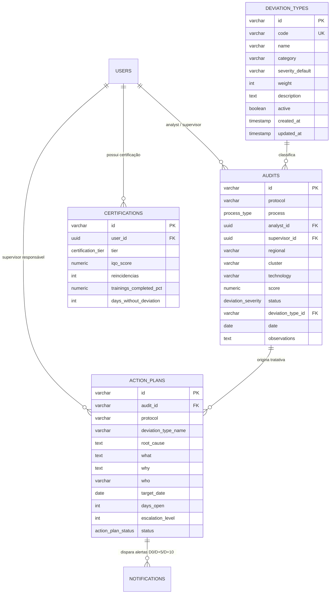

# 🗄️ Arquitetura de Banco de Dados — CQO COP Rede

Este diretório contém os scripts formais de **Definição de Dados (DDL)** e **Carga Inicial (DML / Seed)** para o banco de dados corporativo do **CQO (Central de Qualidade Operacional)**.

---

## 📋 Sumário dos Recursos

| Arquivo | Descrição |
| :--- | :--- |
| `database/schema.sql` | Script SQL DDL nativo para **PostgreSQL 14+ / Supabase / AWS RDS** com enums, tabelas, constraints, índices e triggers automáticos de `updated_at`. |
| `database/seed.sql` | Dados iniciais estruturados para homologação e testes de aderência com a base operacional do COP Rede. |
| `prisma/schema.prisma` | Modelo type-safe compatível com **Prisma ORM** para desenvolvimento com TypeScript / Node.js. |
| `.env.example` | Exemplo de variáveis de conexão (`DATABASE_URL`, credenciais, webhooks). |

---

## 🏛️ Entidades & Relacionamentos



---

## 🚀 Como Executar Localmente com Docker e PostgreSQL

### 1. Subir instância local do PostgreSQL
```bash
docker run --name postgres-cqo \
  -e POSTGRES_USER=postgres \
  -e POSTGRES_PASSWORD=sua_senha_segura \
  -e POSTGRES_DB=cqo_cop_rede \
  -p 5432:5432 \
  -d postgres:16-alpine
```

### 2. Executar o Schema e o Seed
```bash
# Executa a criação das tabelas e índices
psql -h localhost -U postgres -d cqo_cop_rede -f database/schema.sql

# Executa a carga inicial de dados
psql -h localhost -U postgres -d cqo_cop_rede -f database/seed.sql
```

### 3. Ou utilizando Prisma ORM
```bash
# Instalar prisma CLI
npm install -D prisma @prisma/client

# Gerar o banco e aplicar migrações automaticamente
npx prisma db push

# Visualizar os dados pelo Prisma Studio
npx prisma studio
```
